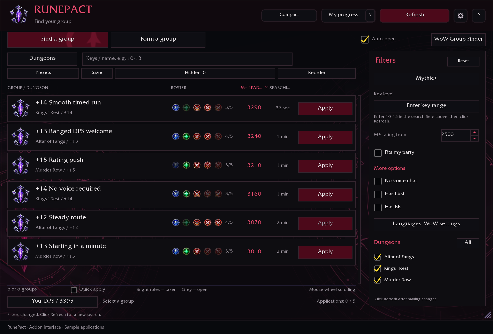
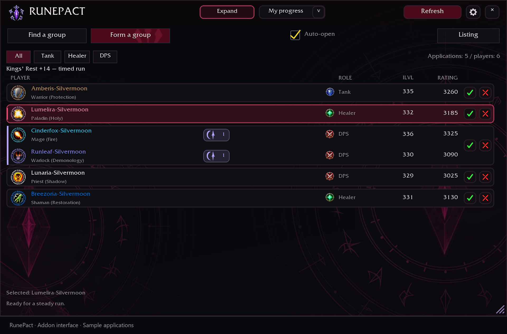
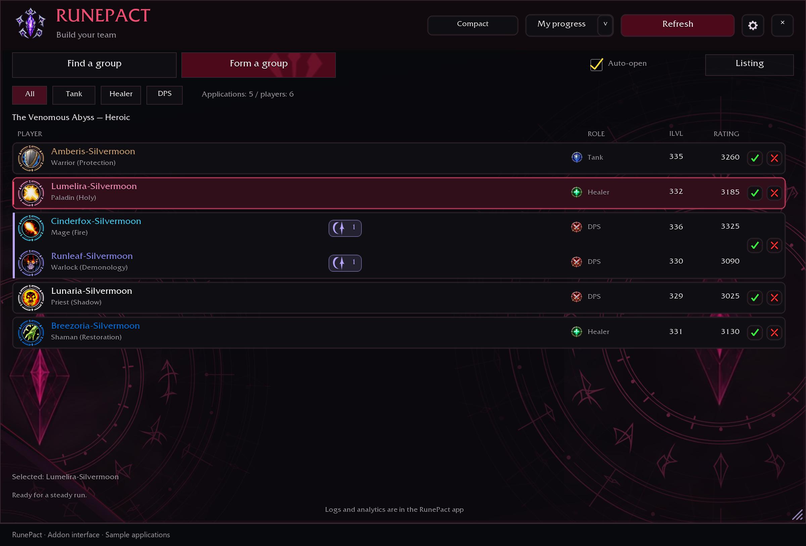
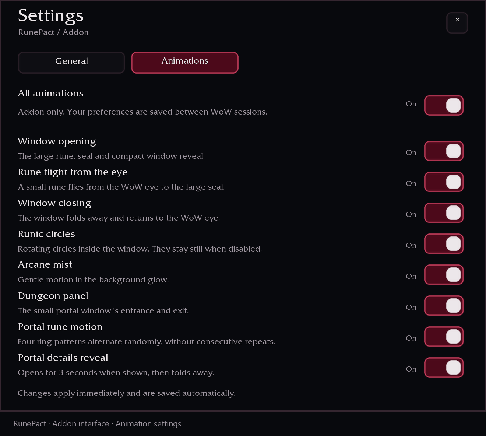
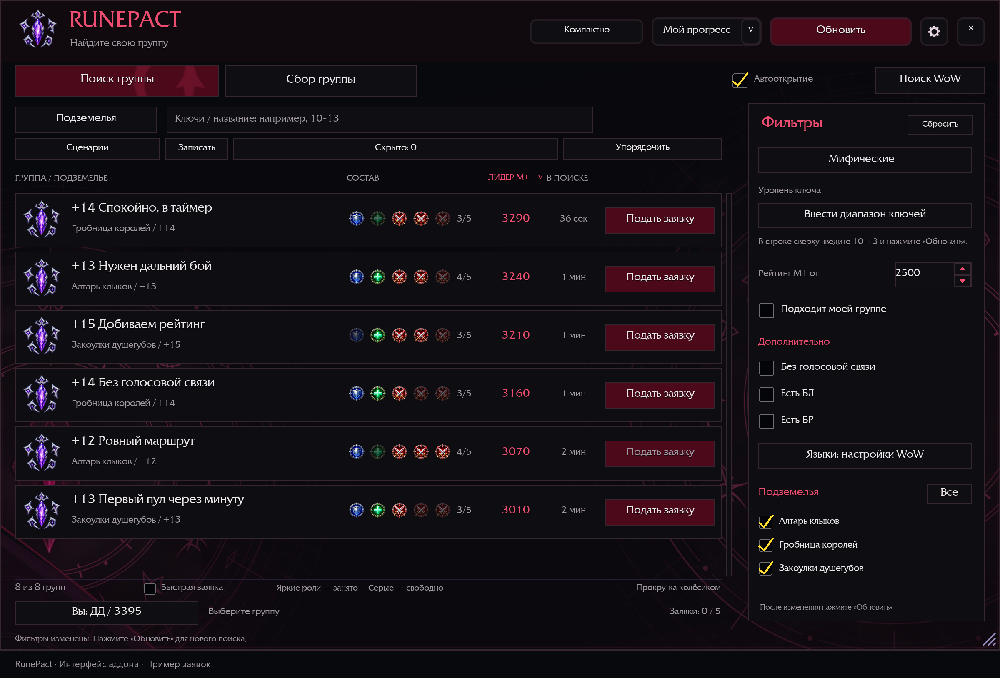
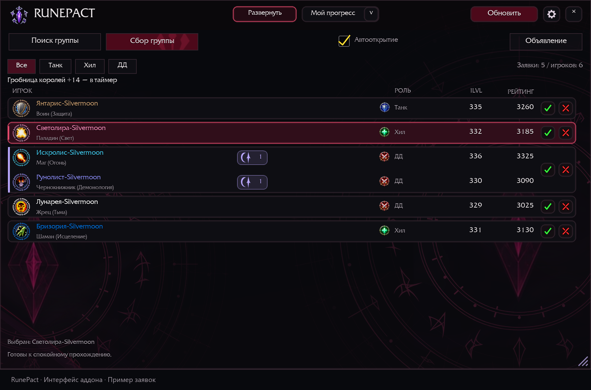
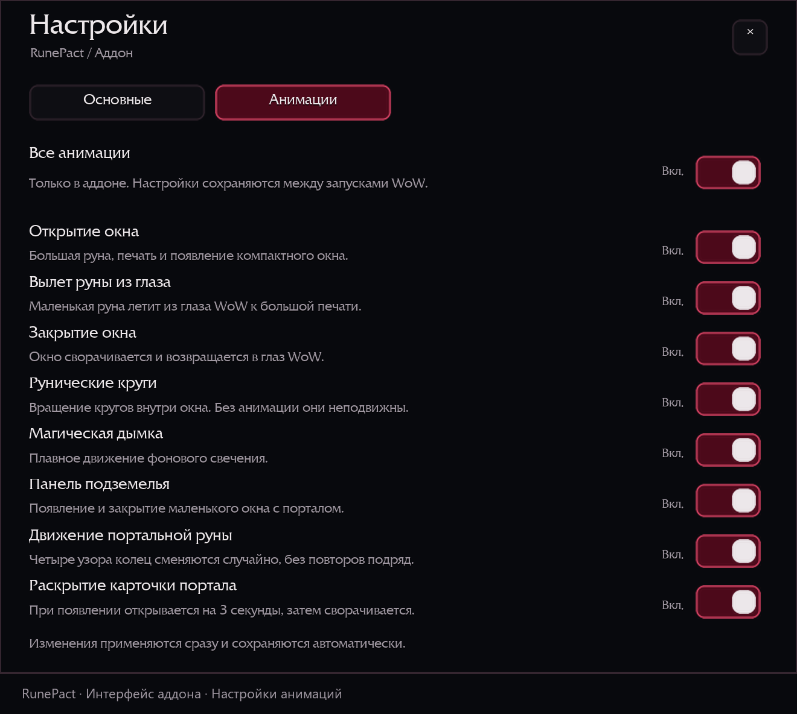

# RunePact addon interface / Интерфейс аддона

Version / Версия: 1.27.5.

Images rendered from the actual addon interface with sample groups and applications, without the WoW game background.
Изображения построены по интерфейсу аддона с примерами групп и заявок, без игрового фона WoW.

## English

### Dungeon search and filters

### Group recruitment and joint applications

### Raid recruitment: roles, item level and rating

### Addon animation settings

## Русский

### Поиск подземелий и фильтры

### Сбор группы и совместные заявки

### Сбор рейда: роли, уровень предметов и рейтинг

### Настройки анимаций аддона

